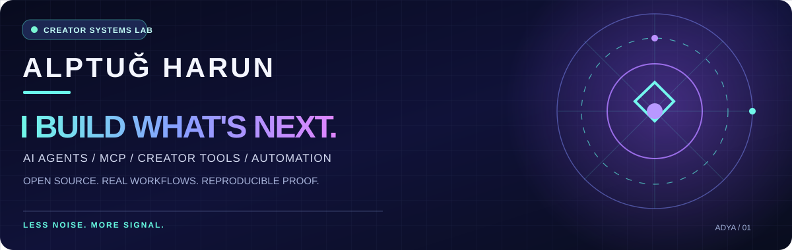

<div align="center">



**SOCIAL MEDIA SPECIALIST · DIGITAL CONTENT CREATOR · CREATIVE STRATEGIST · PRACTICAL AI SYSTEMS**

[ENGLISH](README.md) · [TÜRKÇE](README_TR.md)

</div>

## 🚀 THE SHORT VERSION

I'm **Alptuğ Harun — Social Media Specialist, Digital Content Creator and Creative Strategist**. I build practical AI systems around the creator work I actually do, then publish the proof, limits and failures too.

Creators get usable tools. Builders get inspectable systems. Brands get workflows that can be explained.

**Don't take my word for it:** [open the live app](https://alptugharun.github.io/ai-social-media-toolkit/) or [try to break it in 60 seconds](https://github.com/alptugharun/ai-social-media-toolkit/issues/178).

### ⌁ PICK YOUR PORTAL

| 01 / JUST EXPLORING | 02 / READY TO BUILD | 03 / NEED CREATOR TOOLS |
| :--- | :--- | :--- |
| [**2-minute first run →**](https://github.com/alptugharun/ai-social-media-toolkit/blob/main/START-HERE.md) | [**MCP server →**](https://github.com/alptugharun/ai-workbench-mcp) | [**⚡ Open live Frame Studio →**](https://alptugharun.github.io/ai-social-media-toolkit/) |
| No paid model or login for the local check | Read-only prompt + assistant tools | Local-first social-image framing and export |

**New to AI workflows / MCP / Agent Skills?** [🧭 Start from zero](https://github.com/alptugharun/ai-social-media-toolkit/blob/main/docs/START-FROM-ZERO.md) · [🛡 How the trust scores work](https://github.com/alptugharun/ai-social-media-toolkit/blob/main/docs/TRUST-MATRIX.md)

**Prefer a download?** [⬇ v0.3.0-alpha.1 release — Agent Skills, Context Builder, Frame Studio & checksums](https://github.com/alptugharun/ai-social-media-toolkit/releases/tag/v0.3.0-alpha.1)

### 🛡 TRUST & VERIFICATION SNAPSHOT

- **19 installable Agent Skills** with a beginner guide for every skill, a shared context foundation and contract tests that fail if future skills ship without documentation.
- **3 deliberately read-only MCP tools** in AI Workbench MCP: no network, shell, account access or file writes; published to PyPI and the official MCP Registry.
- **Supply-chain controls:** CodeQL, Dependabot, SHA-pinned GitHub Actions, least-privilege workflow tokens, private vulnerability reporting, versioned checksums and Sigstore-signed release assets.
- **External review:** [OpenSSF Scorecard](https://scorecard.dev/viewer/?uri=github.com/alptugharun/ai-social-media-toolkit) · [M8ven Trust Index](https://m8ven.ai/mcp/alptugharun/ai-social-media-toolkit) · [Trust Matrix](https://github.com/alptugharun/ai-social-media-toolkit/blob/main/docs/TRUST-MATRIX.md).
- **Important:** external scanners can lag behind `main`. A badge is evidence, not a security certificate; current code, tests and limitations stay the source of truth.

## ✦ THE BUILD DECK

<table><tr><td width="50%" valign="top"><h3>⚡ AI SOCIAL MEDIA TOOLKIT</h3><p><strong>From idea to a working workflow.</strong></p><p>Agent Skills, assistants, creator workflows, reproducible first run.</p><a href="https://github.com/alptugharun/ai-social-media-toolkit/blob/main/START-HERE.md">▶ Run first proof</a> · <a href="https://github.com/alptugharun/ai-social-media-toolkit">Source</a></td><td width="50%" valign="top"><h3>🔌 AI WORKBENCH MCP</h3><p><strong>Small surface. Real utility.</strong></p><p>Three read-only tools for prompts and assistant blueprints.</p><a href="https://github.com/alptugharun/ai-workbench-mcp">▶ Setup &amp; diagnostics</a> · <a href="https://github.com/alptugharun/ai-workbench-mcp/issues/5">Host testing</a></td></tr><tr><td valign="top"><h3>🛡️ SKILL SAFETY AUDITOR</h3><p><strong>Inspect before you install.</strong></p><p>Offline, human-reviewable findings. Not a security certification.</p><a href="https://github.com/alptugharun/agent-skill-safety-auditor">▶ Try the scanner</a></td><td valign="top"><h3>📡 CREATOR SIGNAL LAB</h3><p><strong>Less guessing. More signal.</strong></p><p>Explainable CSV scoring for content opportunities and outlier posts.</p><a href="https://github.com/alptugharun/creator-signal-lab">▶ Explore examples</a></td></tr></table>

> **Shipped beta:** [Creator Frame Studio v0.3](https://alptugharun.github.io/ai-social-media-toolkit/) is now on `main` with quick text styles, guide profiles and a deterministic preflight card. It stays local-first: no model call, no automatic publishing, no fake quality score.

## ⌘ TEST BEFORE YOU TRUST

```bash
git clone https://github.com/alptugharun/ai-social-media-toolkit.git
cd ai-social-media-toolkit
python tools/first_run_check.py
```

This is a **local verification**, not proof of compatibility with every AI platform or production system. Start with [troubleshooting](https://github.com/alptugharun/ai-social-media-toolkit/blob/main/START-HERE.md), review [security notes](https://github.com/alptugharun/ai-social-media-toolkit/blob/main/SECURITY.md), and report reproducible bugs.

**PROOF LADDER:** Blueprint → Offline tested → Real host verified → Independent adoption evidence.

## 🧪 CURRENTLY IN THE LAB

- **Creator Frame Studio v0.3 beta:** shipped to `main` after repository CI, static smoke checks and desktop + 390×844 browser-render review. Beta still means review your exports before publishing.
- **MCP Permission Inspector beta:** shipped inside the Toolkit as a local-only first-connect config review. It accepts UTF-8 JSON with optional BOM, does not launch servers, and is **not** a security certificate. [Scope & evidence →](https://github.com/alptugharun/ai-social-media-toolkit/blob/main/resources/MCP-PERMISSION-INSPECTOR.md)
- **Creator research:** offline scorers are not live trend data, scraper access, or a virality predictor.

## 👀 WHY FOLLOW THIS PROFILE?

I publish the parts that are usually hidden behind polished launch posts:

- **working AI workflows** that can move across ChatGPT, Claude, Gemini and Grok;
- **Agent Skills + MCP experiments** with explicit permissions, tests and failure boundaries;
- **creator tools** I actually use for social content, research and visual production;
- **build notes from failures** — what broke, what the metric did *not* prove, and what changed after testing.

If you prefer “look what AI can do” demos with no source, this probably is not the profile for you. If you want **usable systems + visible proof**, you are in the right place.

**Shape the roadmap:** [🧪 Try the live demo + report the first friction](https://github.com/alptugharun/ai-social-media-toolkit/issues/178) · [💡 Suggest a feature or leave constructive feedback](https://github.com/alptugharun/ai-social-media-toolkit/issues/169) · [Join Discussions](https://github.com/alptugharun/ai-social-media-toolkit/discussions). Reproducible criticism is more useful than generic praise; disclose security issues privately.

## 🤝 NEED ONE OF THESE SYSTEMS ADAPTED TO YOUR WORKFLOW?

I also turn proven open-source workflows into **managed AI workflow setups, creator-ops systems and custom implementations** for real teams/brands.

[See the implementation scope →](https://github.com/alptugharun/ai-social-media-toolkit/blob/main/docs/PAID-IMPLEMENTATION.md) · [Work with me →](https://alptugharun.com)

No fake case-study numbers, no “AI transformation” package before the actual job is clear.

## ↗ OUTSIDE THE TERMINAL

[Website / work together](https://alptugharun.com) · [AI articles](https://alptugharun.hashnode.dev) · [Bluesky](https://bsky.app/profile/alptugharun.bsky.social) · [YouTube](https://www.youtube.com/channel/UCe_gK6eaxt-M-XWecxXnB1Q) · [LinkedIn](https://www.linkedin.com/in/alptugharun/) · [Behance](https://www.behance.net/alptugharun/) · [Instagram](https://www.instagram.com/alptug.harun/)

**ADYA Creative** — my AI-supported creative, social-media and brand-strategy work.  
**Yeşil Dijital Akademi** — the environmental, sustainability and technology education/communication initiative I co-founded with **Ahu Nur Şahin Harun**.

<div align="center">

### NO EMPTY HYPE. JUST BETTER SYSTEMS.

*Build something useful. Show the proof. Share the limits.*

</div>
